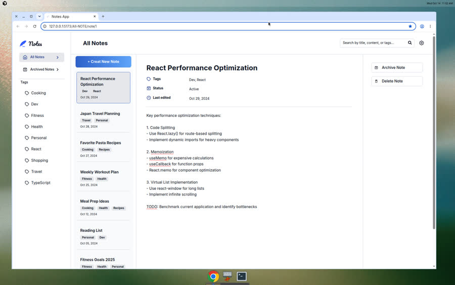

# Notes App

تطبيق ويب حديث لتدوين وتنظيم الملاحظات، مبني بـ **React** و **TypeScript** و **Vite**.

[Live Demo](https://note-app-website.vercel.app)

---

## Demo



> الواجهة الرئيسية: قائمة الملاحظات، التفاصيل، الوسوم، والبحث — كل ذلك في تخطيط ثلاثي الأعمدة.

---

## المشكلة التي يحلها والفئة المستهدفة

### المشكلة
كثير من الناس يكتبون أفكارهم ومهامهم ومعلوماتهم في أماكن متفرقة (ملاحظات عشوائية، رسائل، ملفات)، فيصعب:
- العثور على ملاحظة بسرعة
- تنظيم المحتوى حسب الموضوع (وسوم)
- فصل الملاحظات النشطة عن القديمة/المؤرشفة
- استخدام نفس الأداة بشكل مريح على الديسكتوب والجوال

### الفئة المستهدفة
- الطلاب والمطورون الذين يحتاجون مكاناً منظماً لملاحظات التعلم والمشاريع
- أي مستخدم يريد تطبيق ملاحظات بسيط وسريع بدون تعقيد أو تسجيل حساب
- من يفضل واجهة واضحة مع بحث وفلترة بالوسوم وأرشفة

---

## أهم الميزات التي تم تطويرها

| الميزة | الوصف |
|--------|--------|
| إدارة الملاحظات | إنشاء، تعديل، حذف (مع تأكيد)، وأرشفة/إلغاء أرشفة |
| البحث الفوري | البحث في العنوان والمحتوى والوسوم مباشرة من شريط البحث |
| الوسوم (Tags) | تصنيف الملاحظات وفلترة القائمة حسب الوسم المختار |
| الأرشفة | فصل الملاحظات النشطة عن المؤرشفة في صفحات مستقلة |
| الثيم فاتح/داكن | إعدادات مظهر مع حفظ التفضيل في `localStorage` |
| تجربة موبايل | تخطيط وتنقل مخصص للموبايل (Footer / صفحات منفصلة) |
| حفظ محلي | الملاحظات تُحفظ في المتصفح عبر `localStorage` مع بيانات أولية للتجربة |

---

## التحديات التي تم حلها

1. **تصميم متجاوب (Desktop + Mobile)**  
   بناء تخطيط سطح مكتب بثلاثة أعمدة، مع تجربة موبايل منفصلة (صفحات وتنقل مختلفة) بدل ضغط نفس الواجهة على الشاشات الصغيرة.

2. **إدارة حالة الملاحظات**  
   تنظيم عمليات الإضافة/التعديل/الحذف/الأرشفة عبر Context، مع مزامنة مستمرة إلى `localStorage` حتى تبقى البيانات بعد إعادة التحميل.

3. **البحث والفلترة معاً**  
   الجمع بين حالة الأرشفة، والوسوم من الـ URL، والبحث النصي بحيث تبقى النتائج متسقة أثناء التنقل بين الصفحات.

4. **توجيه الصفحات (Routing)**  
   مسارات واضحة للملاحظات العادية، المؤرشفة، الموسومة، والملاحظة الجديدة، مع عرض التفاصيل بشكل صحيح حسب السياق.

5. **الثيم بدون وميض أبيض**  
   تطبيق الثيم مبكراً عند التحميل ومزامنته مع React حتى لا يظهر وميض عند تبديل الوضع الفاتح/الداكن.

---

## Tech Stack

- **React 19** — UI
- **TypeScript** — Type safety
- **Vite** — Build & dev server
- **React Router** — Client-side routing
- **Tailwind CSS** — Styling
- **React Hot Toast** — Notifications
- **React Icons** — Icons

---

## Getting Started

```bash
npm install
npm run dev
```

ثم افتح الرابط الذي يظهر في الطرفية (عادة `http://localhost:5173`).

```bash
npm run build    # production build
npm run preview  # preview the build
```

---

## Project Structure

```
src/
├── components/   # أزرار، مودالات، ملاحظات، وسوم، UI
├── contexts/     # Notes + Theme + Editor
├── hooks/        # فلترة، تنقل، إشعارات
├── layout/       # Sidebar / Header / Mobile layout
├── pages/        # صفحات الملاحظات والبحث والموبايل
├── router/       # إعداد المسارات
├── services/     # منطق الحفظ / الحذف / الأرشفة / البحث
├── types/        # تعريفات TypeScript
└── lib/          # دوال مساعدة
```

---

## License

Private / personal project.
